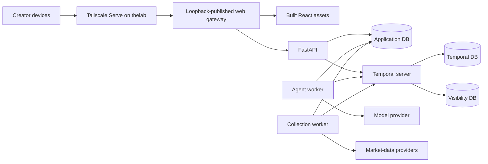

# Private homelab runtime

Status: **proposed for review** (2026-10-09). This is an implementation handoff, not a deployed configuration. It does not change the accepted product or data-policy decisions in the rest of the knowledge base.

## Context and decision

The current `infra/compose.yaml` is a local development dependency stack. It starts two PostgreSQL containers, Temporal `auto-setup`, and Temporal UI; `dev.py` starts the API and agent worker on the developer machine. It does not yet run the complete application on `thelab`. The first private deployment needs the same logical services supervised on one 6-core/12-thread, 15 GiB Ubuntu host, available only to the creator over Tailscale.

**Proposed decision:** use a separate, pinned Docker Compose deployment for this single host, with Tailscale Serve on the host as the only client ingress. Keep the development Compose file independent. Use one PostgreSQL server with isolated application, Temporal default, and Temporal visibility databases and separate roles. Put its active data on the NVMe. Run the web gateway, API, collection worker, agent worker, Temporal server, and database as separately supervised services. A local Kubernetes cluster adds control-plane and operational work without a current scaling need; revisit it when a measured requirement appears. This choice does not merge the logical boundaries in [system-architecture.md](../system-architecture.md).

The initial deployment has **no backup or restore process**, as the user decided. A disk or host failure may lose market catalog, bars, conversation history, and Temporal history. This is a conscious private-deployment risk, not evidence that the data are backed up elsewhere. Backups and tested restore become a gate before relying on retained research or inviting traders; see [operations-and-load.md](../operations-and-load.md).

## Runtime topology

| Deployable | Responsibility and access | Initial process rule |
| --- | --- | --- |
| Host Tailscale + Serve | Tailnet HTTPS to one local web port; owner-device ACL; no Funnel | Host service, independent of Compose. Verify Serve status after reboot. |
| Web gateway | Serve built frontend and proxy `/api/` to FastAPI on the internal network | Only host-published application port, bound to `127.0.0.1`; no direct API publish. |
| API/query | Validate requests, execute explorer SQL, manage agent turns, start Temporal workflows | One instance initially; internal network only. No provider or model key. |
| Collection worker | Poll `market-backfill`, `market-session`, and `market-catalog`; call providers and write normalized data | **One process** initially, retaining the present process-local provider limiter. Its three queues are distinct, but share one process; session work has reserved activity capacity. |
| Agent worker | Poll `market-eagle-agent`; perform bounded model calls and analytical reads; persist turn state | Separate process and credentials from collection. One instance initially. |
| Temporal server | Durable scheduling, histories, and workflow visibility | Pinned self-hosted server configuration; no `auto-setup` image in the deployment stack. Internal gRPC only. |
| PostgreSQL | Application data and two Temporal persistence databases | One server/container on NVMe with isolated databases and credentials. No host-published port. |
| Temporal UI | Operator inspection | Optional internal service; reach only by an operator-controlled local/SSH tunnel, not the owner-facing Serve route. |

The existing agent store is a SQLite file shared by two host processes. Before the API and agent worker become separate containers, move conversations, turns, evidence, and traces into application PostgreSQL, or explicitly design one shared, durable file volume with consistent migration and access. **The proposed target is PostgreSQL**, matching [data-model.md](../data-model.md); that implementation is assigned separately. Do not package the current `local-data/agent.sqlite` path into an ephemeral container layer.

One Compose project should own service startup, restart policies, internal networking, and health dependencies. Build immutable API/worker/frontend images from a reviewed commit and record their tags/digests in the deployment manifest. Use the same backend image for API and worker commands, while granting each service only its own credentials and secrets. Do not use Vite, Uvicorn `--reload`, the synthetic repository fallback, or the development `auto-setup` image in this deployment. If live source/basis selection is still unresolved, keep the real-data explorer disabled or clearly marked untrusted; do not silently serve fictional fixture data as live market data.

## Persistent placement and database ownership

Create a host directory on the NVMe (for example `/var/lib/market-eagle/postgres`) and bind-mount it into the PostgreSQL data directory. Confirm with `findmnt` that the resolved path is on the NVMe filesystem before first initialization; the existing Docker named-volume location must not be assumed. Keep PostgreSQL data, WAL, and active indexes on NVMe. Do not place Temporal persistence on `/srv/storage` merely because the HDD is larger. The HDD has no backup role in this initial deployment.

Initialize `market_eagle`, `temporal`, and `temporal_visibility` as separate databases. Use dedicated login roles: `app_migrator` for reviewed schema changes, `app_ingest` for catalog/bar writes, `app_api` for market reads and conversation/API writes, `app_agent` for market reads and agent-state writes, and `temporal_service` only for its two databases. Further split the API/agent write and read roles if the repository implementation makes that practical. Neither API nor agent needs provider write privileges; neither collection nor Temporal needs conversation access. Provision roles and grants with a repeatable, idempotent bootstrap/migration step, not a developer command that silently rotates a read-only password. Use a read-only market-data role and statement timeout for analytical execution; agent tool calls remain read-only even though the agent worker writes its own turn state.

Run application migrations as a one-shot, reviewed deployment step before new API/worker images start. Run Temporal database schema setup and upgrades as explicit, version-matched steps before a new Temporal server image starts. An upgrade must not be performed by container restart or image tag drift. Record migration version, server version, and rollback decision in the release log. With no backup, rollback after a destructive schema change cannot be guaranteed; block such changes until a recovery plan is accepted.

## Private access and secrets

The gateway listens on the host loopback only. Configure [Tailscale Serve](https://tailscale.com/docs/features/tailscale-serve) to proxy its tailnet HTTPS address to that local port; explicitly verify that [Funnel](https://tailscale.com/docs/features/tailscale-funnel) is not configured. Restrict the Serve destination to the creator's identity/devices with tailnet grants or ACLs, and test from an allowed device and a denied device. The gateway routes `/api/` internally; the browser uses same-origin requests. PostgreSQL, Temporal gRPC, and Temporal UI have no public or tailnet listener. Do not treat Tailscale access as user identity inside the app; the accepted private shared-conversation behavior applies to everyone who reaches this tailnet route.

Store database passwords and provider/model keys in administrator-managed files outside the repository (for example `/etc/market-eagle/secrets/`) and mount them only into the services that need them with Compose secrets. Set host ownership and permissions so the intended container UID can read its own mounted secret, while other services cannot. The collection worker receives Alpaca/FMP keys; the agent worker receives the model key; the API receives neither. The gateway has no database credentials. Use file-reading settings or `_FILE` conventions instead of placing secret values in Compose environment declarations, image layers, command-line arguments, logs, or Temporal payloads. Rotate credentials with a documented restart order. The committed `infra/.env.example` remains a development example, never the deployment secret source. [Compose secret mounts](https://docs.docker.com/compose/how-tos/use-secrets/) support per-service access.

## Readiness, capacity, and operation

Use container liveness checks for process restart and separate readiness checks for dependency access. PostgreSQL readiness is `pg_isready`; Temporal readiness must verify the namespace and persistence path; API readiness must verify its database and Temporal connection when agent mode is enabled. A static `{"status":"ok"}` response is liveness only. Check that each worker is polling its expected task queues; a running container without pollers is not healthy. The gateway should return a clear unavailable response while the API is not ready. Use Compose `depends_on: condition: service_healthy` for startup ordering, but keep retry/reconnect logic because dependencies can fail later. [Compose startup behavior](https://docs.docker.com/compose/how-tos/startup-order) only gates startup.

Before setting CPU/memory limits, run a baseline on the 15 GiB host with a representative backfill, hourly refresh, explorer query, and agent turn. Measure **full-universe, five-year analytical queries** as tracked in [performance issue #21](https://github.com/maorts14/market-eagle/issues/21). The five-stock/two-year synthetic fixture verifies calculations and contracts; it is **not** a capacity benchmark. Record host RAM/swap, PostgreSQL and Temporal memory, DB IO and p95 query latency, worker queue delay, provider lag, and model calls. Start with one collection process and one agent process; do not add collection replicas while its provider rate limiter is process-local. Reserve session queue capacity so a backfill cannot block same-day refresh. Set container limits from the measured peak with headroom for Ubuntu, Tailscale, and PostgreSQL, then verify the host does not swap under the mixed workload.

Collect structured container logs with retention/rotation and expose internal metrics for API latency/errors, Temporal service/workers, PostgreSQL, disk use, schedule lag, stale bars, missing-symbol coverage, and failed workflows. Alerting can begin with local operator notification; it must include a missed scheduled refresh and disk-full warning. A health page alone does not establish data freshness. Keep provider bodies and secrets out of logs.

## Temporal bootstrap and upgrades

Create a dedicated `market-eagle-private` namespace with explicit retention and verify it before workers start. Register schedules with an **idempotent operator bootstrap** that compares desired schedule IDs/specifications with existing ones and creates or updates them without duplicate histories. Pin the schedule inputs to a published catalog snapshot at workflow start and the configured source/feed/basis. Bootstrap must be rerunnable after restart.

- `session-refresh`: New York timezone, hourly ticks anchored to regular-session open (initial implementation may use 09:30–15:30 on weekdays), with exchange-calendar checks for holidays and half-days. Use one deterministic workflow ID per session/tick. Skip overlap when the previous refresh is active. Include bounded after-close checks as a separate explicit schedule/policy once provider behavior is measured.
- `session-reconcile`: one run on the next New York calendar day for the prior trading session, using the exchange calendar to skip non-session dates. Use a deterministic workflow ID per session/source/feed/basis; targeted repairs remain operator-triggered.
- `catalog`: first publication and subsequent changes remain **manual review** until provider rights and catalog change policy are settled. Do not silently publish a scheduled FMP response.
- `historical-backfill`: one operator-triggered workflow for the pinned five-year window, not a recurring schedule.

Bootstrap verifies namespace, schedule presence/state, task-queue pollers, and one dry-run or synthetic schedule path before live collection is enabled. It must not create live provider work by merely running migrations. Record missed ticks and permit a deliberate targeted repair/reconcile, not an automatic replay of every missed hourly snapshot.

Pin Temporal server and Python SDK versions to a tested compatibility set. Before upgrades, read [Temporal's self-hosted upgrade guidance](https://docs.temporal.io/self-hosted-guide), apply version-matched schema migrations in the documented order, then roll the server and workers in a planned sequence. Replay-test in-flight workflow histories or use a compatible workflow-versioning strategy before changing workflow code; a new worker must be able to process old histories or old workers must remain until they finish. [Temporal workflow versioning](https://docs.temporal.io/workflow-definition) addresses replay compatibility. With no initial backup, do not attempt an upgrade that requires irreversible schema changes or cannot be rolled back safely; defer it until backup/restore is accepted.

## Implementation handoffs and acceptance

| Owner | Required deliverable | Review evidence |
| --- | --- | --- |
| Infrastructure | New homelab Compose manifest, immutable image build, loopback-only gateway, internal network, NVMe bind mount, health checks, startup/upgrade runbook | `docker compose config` has no published DB/Temporal/API ports; host mount resolves to NVMe; restart test returns all services to ready state. |
| Backend/data | Application DB roles and grants, explicit migration job, PostgreSQL-backed agent state, no synthetic fallback in deployed mode | Integration test uses service-specific roles; API cannot write bars; agent cannot write bars; collection cannot read/modify conversations. |
| Ingestion | Idempotent namespace/schedule bootstrap and operator commands; provider limiter remains singleton or becomes shared before scaling; schedule/status metrics | Bootstrap twice yields the same schedules; holiday/half-day and overlap tests; missed tick visible; no provider call during bootstrap verification. |
| Interface/API | Built frontend served through gateway; same-origin API, real mode explicitly selected; readiness endpoints | Allowed Tailscale device can open explorer and agent; denied device and LAN cannot; no direct DB/Temporal reachability. |
| Lead/release | Version compatibility matrix, initial sizing run including [issue #21](https://github.com/maorts14/market-eagle/issues/21), secrets inventory, migration order, failure/rollback drill, known data-loss acknowledgment | Reviewable release record with full-universe query measurements; normal restart and a failed-dependency recovery test; no claim of backup or HA. |

Before enabling real collection, verify provider entitlements and selected source/feed/basis. Before considering the private deployment complete, demonstrate catalog publication, a bounded backfill, one refresh, one reconciliation, an explorer query, and an agent turn through the deployed boundaries. This ADR is fulfilled when these handoffs are implemented and reviewed; it does not itself deploy them.
